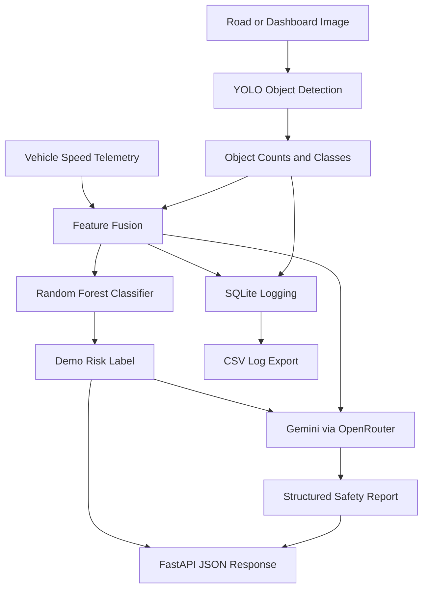

# 🚗 AI-Powered Autonomous Vehicle Collision Risk Predictor

**An experimental AI pipeline for road-scene understanding, vehicle risk-level classification, and automated safety reporting.**

## 📌 Overview

The **AI-Powered Autonomous Vehicle Collision Risk Predictor** is an educational prototype that integrates Computer Vision, tabular Machine Learning, Generative AI, and REST API development into a unified workflow.

The system analyzes a road or dashboard-camera image, detects visible objects using a YOLO-based model, combines the detection count with vehicle-speed telemetry, and produces an experimental safety-level classification. It can also generate a structured, human-readable scene analysis report through a Gemini model accessed via OpenRouter.

The project demonstrates how multiple AI components can work together to transform visual and numerical inputs into structured, interpretable outputs.

## 🎯 Problem Statement

Road environments contain vehicles, pedestrians, cyclists, and other objects that may require a driver's attention. Object detection identifies visible objects, but detection alone does not determine the actual risk of a collision.

This project explores a unified pipeline that combines visual object detection, vehicle-speed information, tabular ML classification, persistent data logging, and AI-generated reporting.

**Important distinction:** The current prototype estimates a demonstration risk category from vehicle speed and detected-object count. It does not calculate a validated collision probability or establish actual collision risk.

## ✨ Key Features

### 1. Computer Vision — Object Detection
- Processes road and dashboard-camera images.
- Uses a YOLO-based object detection model through Ultralytics.
- Extracts object classes, confidence scores, and bounding-box coordinates.
- Counts detected objects and generates annotated images.
- Exports detection results to CSV and JSON.

The available classes depend on the loaded model's trained class definitions. The current model configuration includes:

- Car
- Van
- Truck
- Pedestrian
- Person sitting
- Cyclist

### 2. Speed and Detection Data Fusion
- Accepts vehicle speed in kilometers per hour.
- Combines speed telemetry with the total number of detected objects.
- Structures the resulting features for downstream ML inference.
- Records scene-analysis information for later inspection.

### 3. Tabular Machine Learning
- Uses a Scikit-learn Random Forest classifier.
- Predicts one of three demonstration labels: `Safe`, `Alert`, or `Critical`.
- Saves and reloads the trained model using Joblib.
- Separates the risk-classification stage from the computer-vision stage.

**Training-data limitation:** The current risk classifier uses synthetic data with rule-generated labels. Its evaluation results measure agreement with those synthetic rules, not real-world safety performance.

### 4. Generative AI Safety Reports
- Integrates a Gemini model through the OpenRouter API.
- Sends the vehicle speed, detected-object count, class counts, and ML label to the language model.
- Requests structured JSON containing:
  - Scene summary
  - Observed facts
  - Limitations
  - Cautious recommendations
- Handles unavailable LLM services without necessarily losing the computer-vision and ML results.

### 5. REST API with FastAPI
The application exposes endpoints for health checks, scene analysis, and stored logs.

| Method | Endpoint | Purpose |
|---|---|---|
| `GET` | `/` | Project information and endpoint overview |
| `GET` | `/health` | Check model loading and LLM configuration |
| `POST` | `/analyze-scene` | Analyze an uploaded image and supplied speed |
| `GET` | `/logs` | Retrieve recent scene-analysis records |

The `/analyze-scene` endpoint accepts a multipart form containing an image and `speed_kmh`, then returns a combined JSON response.

### 6. Database and Output Logging
- Uses SQLite to persist scene-analysis records.
- Stores timestamps, speed, detection counts, class counts, risk labels, and detection details.
- Exports logs to CSV for further analysis.
- Saves annotated images and model-related outputs.

## 🔄 System Architecture



## 🛠️ Technology Stack

| Area | Technologies |
|---|---|
| Programming language | Python |
| Computer vision | OpenCV, Ultralytics YOLO, PyTorch |
| Machine learning | Scikit-learn, Random Forest |
| Data processing | NumPy, Pandas |
| Model persistence | Joblib |
| Generative AI | Gemini via OpenRouter, OpenAI-compatible SDK |
| Backend API | FastAPI, Uvicorn |
| Database | SQLite |
| Development environment | Google Colab |

## 📂 Project Structure

```text
vehicle_collision_project/
├── app.py
├── vehicle_safety.db
├── outputs/
│   ├── best_vehicle_detector.pt
│   ├── risk_model_demo.joblib
│   ├── detections.csv
│   ├── detections.json
│   ├── scene_logs.csv
│   ├── synthetic_risk_training_data.csv
│   └── training_results.csv
└── training/
    └── kitti_yolo11n/
        └── weights/
            └── best.pt
```

The actual files available may vary depending on the notebook execution history. Large model weights and generated databases may be excluded from the public repository.

## 🚀 Getting Started

### 1. Open the Notebook

Upload the project notebook to Google Colab and run its cells in order. The notebook installs dependencies, loads the available detector, processes a test image, prepares the risk classifier, and configures the API.

### 2. Install Dependencies

For a local Python environment:

```bash
pip install ultralytics opencv-python-headless pandas matplotlib scikit-learn joblib fastapi uvicorn python-multipart openai requests
```

### 3. Configure the LLM API

The current implementation uses OpenRouter to access Gemini. Set the required environment variables before starting the API:

```bash
export OPENROUTER_API_KEY="your_api_key"
export OPENROUTER_MODEL="google/gemini-2.5-flash-lite"
```

On Windows PowerShell, use:

```powershell
$env:OPENROUTER_API_KEY="your_api_key"
$env:OPENROUTER_MODEL="google/gemini-2.5-flash-lite"
```

Use your own API key, never commit it to GitHub, and check the provider's current model availability and pricing.

### 4. Start the API

From the directory containing `app.py`:

```bash
uvicorn app:app --host 127.0.0.1 --port 8000
```

Open the interactive API documentation at:

```text
http://127.0.0.1:8000/docs
```

For local development, the API is bound to localhost. A Colab localhost URL is not a publicly accessible deployment URL.

### 5. Test the Pipeline

Use the interactive `/docs` page to submit:
- An image file using the `image` field
- Vehicle speed using the `speed_kmh` field

Inspect the returned JSON for detections, the demonstration risk label, LLM report status, and limitations. Check `/health` and `/logs` to inspect service status and recorded analyses.

## 📊 Outputs

Depending on successful execution and API availability, the pipeline can produce:

- Annotated road-scene images
- Object detection records in CSV and JSON
- Predicted demonstration risk labels
- Structured LLM-generated reports
- SQLite scene-analysis history
- API health and analysis responses

Actual detection quality and report availability depend on the loaded weights, input image, runtime environment, and API configuration.

## ⚠️ Limitations and Responsible Use

This project is an educational prototype, **not a production-ready Advanced Driver Assistance System (ADAS)**.

- The current risk classifier is trained on synthetic, rule-generated labels rather than real accident or near-miss data.
- Speed and object count alone do not establish distance, relative velocity, time-to-collision, braking distance, or collision probability.
- Object detection performance depends on the model's training data and supported classes.
- The Gemini-generated report is an AI-generated interpretation, not an independently verified safety assessment.
- API access may require a valid key and may incur charges.
- The prototype has not been established as safety-certified or validated for real-vehicle control.

Do not use its predictions to control a real vehicle or replace professional safety systems.

## 🔬 Future Improvements

Potential next steps include:

- Train and evaluate the risk model using appropriately labeled real-world driving data.
- Add object tracking across video frames.
- Estimate distance and relative motion using suitable camera calibration, depth estimation, or additional sensors.
- Investigate time-to-collision and braking-distance features with explicit physical assumptions.
- Evaluate detection performance using precision, recall, and mAP on a documented validation dataset.
- Evaluate risk classification using per-class precision, recall, F1-score, and a confusion matrix on held-out real-world labels.
- Add automated tests, structured error handling, configuration management, and deployment documentation.
- Build a dashboard to visualize detections, predictions, and historical logs.

## 📚 Learning Outcomes

This project provides practical experience with:

- Integrating computer vision and tabular ML in one pipeline
- Extracting structured data from model predictions
- Building inference workflows with Scikit-learn
- Calling a hosted LLM through an API
- Designing file-upload endpoints with FastAPI
- Persisting model outputs with SQLite
- Understanding the difference between a working prototype and a validated safety-critical system

## 📄 License

Add a license file before distributing the project publicly. Ensure that the licenses and usage terms of the model weights, datasets, dependencies, and third-party APIs are compatible with your intended use.

---

**Project status:** Experimental prototype / educational demonstration.

**Core pipeline:** Image Detection → Feature Fusion → ML Risk Classification → SQLite Logging → LLM Reporting → FastAPI Response.
